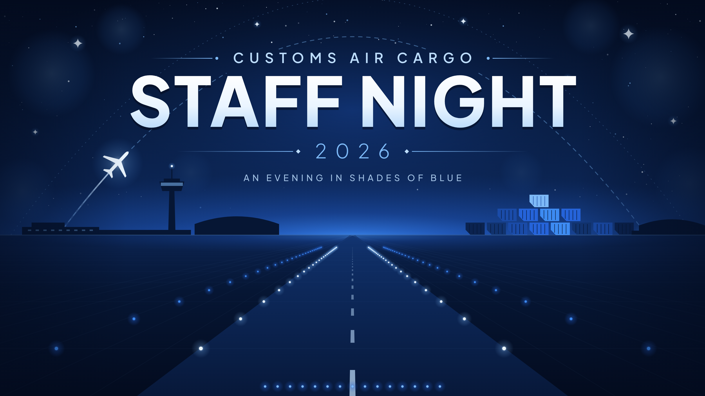
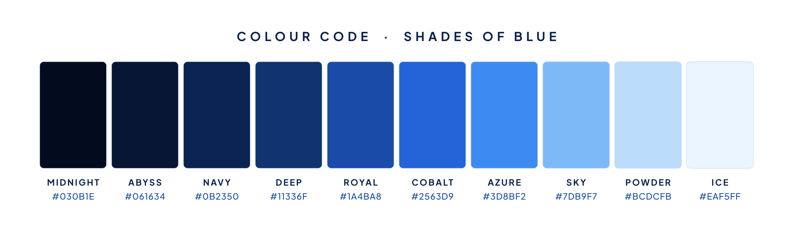

# Customs Air Cargo Staff Night — backdrop



An airfield at night, drawn entirely in shades of blue. A cargo flight climbs from the control tower along a route that arches over the title. The runway and blue taxiway lights lead to stacked air cargo containers on the horizon, one container for each shade.

## Files

| File | Use |
| --- | --- |
| `backdrop.pdf` | **Send this to the printer.** Vector, text converted to outlines, no fonts or images embedded. Scales to any 16:9 size without losing quality. |
| `backdrop-4k.png` | LED wall or projector playback, 3840 × 2160. |
| `backdrop.svg` | Vector master, for opening in Illustrator, Inkscape or CorelDRAW. |
| `colour-code.png` / `.svg` | Swatch card of the colour code, for décor, lighting and dress-code messages. |
| `build.mjs` | Generates all of the above from the text and palette settings at the top of the file. |

## Size and layout

- **Ratio 16:9.** The PDF page is 20 × 11.25 in. It prints at any 16:9 size, such as 16 × 9 ft or 4.8 × 2.7 m, and matches standard LED wall and projector formats.
- **Title kept high.** All text sits in the top 46%, so it stays visible above people standing on stage. The lower half (runway and lights) is decoration and can be hidden behind people, a podium or stage furniture.
- **Safe edges.** Nothing important is within 140 px of any edge (about 7% of the width). The printer can add bleed or hems by extending the background.

## Colour code: shades of blue



| Name | Hex | RGB | Used for |
| --- | --- | --- | --- |
| Midnight | `#030B1E` | 3, 11, 30 | Top of the sky, ground at the bottom edge, title shadow |
| Abyss | `#061634` | 6, 22, 52 | Sky, building silhouettes |
| Navy | `#0B2350` | 11, 35, 80 | Lower sky, ground, containers |
| Deep | `#11336F` | 17, 51, 111 | Horizon, runway surface |
| Royal | `#1A4BA8` | 26, 75, 168 | Glow behind the title, containers |
| Cobalt | `#2563D9` | 37, 99, 217 | Horizon glow, containers |
| Azure | `#3D8BF2` | 61, 139, 242 | Taxiway lights, horizon glow |
| Sky | `#7DB9F7` | 125, 185, 247 | Year, flight routes, dividers |
| Powder | `#BCDCFB` | 188, 220, 251 | "Customs Air Cargo", tagline, runway centre line |
| Ice | `#EAF5FF` | 234, 245, 255 | Title highlight, runway lights, aircraft, stars |

The only colour outside this scale is plain white at the top of the "STAFF NIGHT" lettering.

These are screen (RGB) colours. Ask the printer for a proof: deep navy often prints darker and bright azure duller in CMYK.

## Changing the artwork

Text, year and colours are set at the top of `build.mjs` (`TEXT` and `PALETTE`). To regenerate every file:

```sh
cd backdrops
npm install
npm run build:customs-air-cargo-staff-night
```

The exports use Playwright's Chromium. If it isn't installed yet, run `npx playwright install chromium` once.

## Notes

- **No logos.** The artwork includes no Customs emblem or logo. If the client wants one, use only an official file they supply. The clear sky at the top centre or in either upper corner can take it.
- **Wording.** The tagline "An evening in shades of blue" reflects the event's colour code. Remove or change it in `TEXT` if it isn't wanted.
- **Font.** The lettering is Plus Jakarta Sans (SIL Open Font License 1.1), taken from `public/assets/fonts/` and converted to outlines. Printers don't need the font installed.
